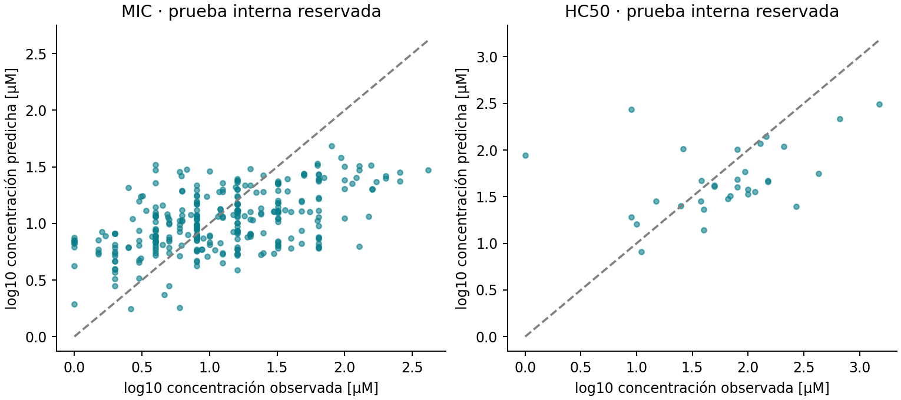
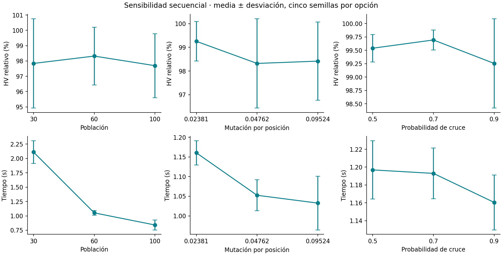
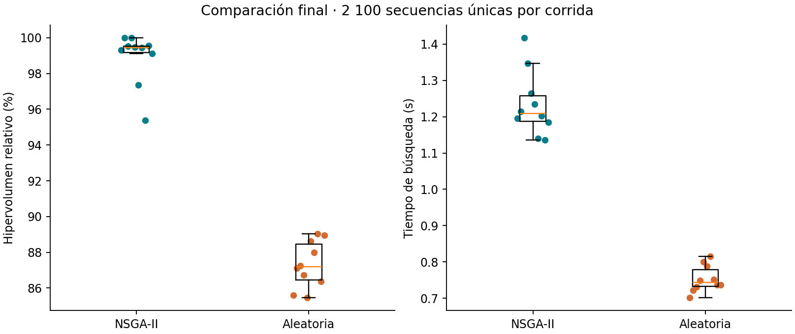
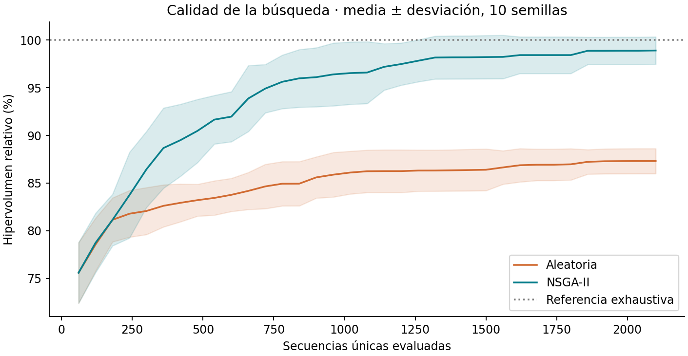
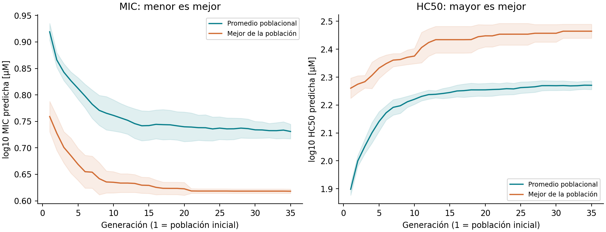
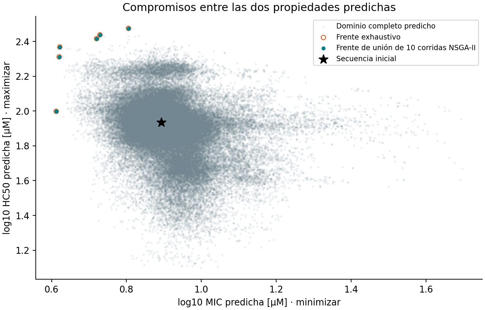

# Búsqueda evolutiva multiobjetivo de variantes de péptidos mediante propiedades predichas

Informe técnico de desarrollo · Computación Evolutiva · Maestría en Inteligencia Artificial

Versión reconstruida con datos públicos. Las tablas y figuras se generan desde los archivos de esta ejecución, sin trasladar las cifras históricas de los notebooks originales. Este documento es la versión ampliada en Markdown. El informe académico se maquetó en 13 páginas en `output/pdf/Informe_CE_Peptidos.pdf`; Integrantes: Ing. MIGUEL HERRERA, WILLY ROBERTO; Ing. PARIHUANA TRAVEZAÑO, OMAR EDUARDO; Ing. TORRES CRISTOBAL, WILBER. Repositorio: https://github.com/erptyl2010/Proyecto-Computaci-n-Evolutiva .

## Resumen

Estudiamos si NSGA-II aprovecha un presupuesto reducido para aproximar el frente de compromiso entre menor MIC y mayor HC50 predichas. La referencia es un dominio de 76,210 secuencias de 21 aminoácidos, con hasta dos sustituciones. Reconstruimos una cohorte de 4,308 fichas de DBAASP y entrenamos dos Random Forest con una partición interna reservada. En diez semillas finales, cada método evaluó 2 100 secuencias únicas. NSGA-II alcanzó mayor hipervolumen medio que la búsqueda aleatoria, con una diferencia emparejada de 11.6023 puntos porcentuales. Esta conclusión describe la búsqueda sobre modelos congelados. No demuestra actividad, seguridad ni superioridad biológica de los candidatos.

## I. Definición y modelado del problema

### Motivación y pregunta

El interés está en el compromiso entre actividad antimicrobiana y hemólisis: una MIC menor y una HC50 mayor son las direcciones deseadas para estos dos indicadores específicos. HC50 no resume todas las formas de toxicidad. DBAASP recoge secuencias, modificaciones y mediciones biológicas con sus referencias, lo que permite construir un problema verificable, aunque heterogéneo [1]. Boone et al. ofrecen un antecedente de integración de algoritmos genéticos y aprendizaje automático para péptidos; su sistema y organismo objetivo son distintos a los de este trabajo [2]. No presentamos esta combinación general como una innovación inédita.

La pregunta es: **con 2 100 consultas únicas a dos predictores congelados, ¿qué calidad de frente alcanza NSGA-II frente a una muestra uniforme sin reemplazo?** La hipótesis algorítmica es que NSGA-II obtiene mayor hipervolumen medio. El alcance es una evaluación computacional de presupuesto limitado sobre un solo paisaje predicho.

### Formulación

La referencia es `s₀ = GFMKYIKPLIPHAVKAIKKLI`. Cada variable `xᵢ` representa un aminoácido del alfabeto de 20 símbolos canónicos, para `i = 1,…,21`. Se impone `d_H(x,s₀) ≤ 2`, sin inserciones ni eliminaciones. Los extremos permanecen en el contexto de anotación ausente usado por los modelos; no se infiere su estado químico desde un campo nulo. La secuencia está presente en la ficha DBAASP 2514, conservada como JSON en esta reconstrucción.

El problema minimiza el vector `F(x) = (m_MIC(x), −m_HC50(x))`, donde cada `m` predice `log10(concentración/µM)`. Es una optimización multiobjetivo: puede haber soluciones de compromiso y no se presupone un único ganador. Las concentraciones mostradas son `10^m`, no mediciones nuevas. El cociente predicho HC50/MIC se usa únicamente para describir una elección posible del frente; no sustituye los dos objetivos.

La cardinalidad exacta es `1 + 21×19 + C(21,2)×19² = 76 210`. No hay restricciones implementadas de síntesis, estabilidad, agregación o toxicidad general. Esta delimitación permite una referencia exhaustiva del modelo y hace posible cuantificar cuánto se obtiene con el 2.7555% del dominio por corrida. No demuestra escalabilidad a secuencias o radios mayores.

### Modelo del proceso y datos

El modelo del proceso se construye con dos regresores Random Forest [3], uno por propiedad. Los datos proceden de la API oficial de DBAASP [1,4]. La instantánea se inició en `2026-10-17T17:12:41.942905+00:00` y terminó en `2026-10-17T17:27:25.990498+00:00`. El filtro solicita monómeros de longitud 10–30, sin aminoácidos inusuales y con registro frente a *E. coli* ATCC 25922. Se descargan todas las fichas devueltas; HC50 se extrae de esa misma cohorte. Esto limita su representatividad frente a un muestreo independiente de todos los datos de hemólisis.

Se conservan únicamente MIC de esa cepa y 50% de hemólisis en eritrocitos humanos, expresadas explícitamente en µM, con concentración puntual, positiva y finita. Se excluyen rangos, desigualdades, valores ±, otras unidades y química no representada. Se usa `concentration`, no el campo `activity`. Las anotaciones terminales ACT y AMD se diferencian de la ausencia de anotación. Se agrupan mediciones de una misma secuencia y anotaciones terminales mediante la mediana. Esto reduce redundancia, pero no armoniza medios, inóculo ni demás condiciones.

Tras procesar 51,867 mediciones de las fichas, se aceptaron 2,069 mediciones MIC y 202 HC50, correspondientes a 1,473 y 199 entidades con secuencia y anotaciones terminales. Cada fila conserva ID, concentración original, condiciones disponibles, referencia original, URL y SHA-256. Los artículos de cada ficha se conservan sin atribuir una medición a un artículo concreto cuando esa correspondencia no se ha verificado.

Se comparan una representación de composición de 27 atributos y otra de 42 que agrega descriptores de orden. Ambas incluyen longitud, frecuencias, carga aproximada, fracción hidrofóbica e indicadores terminales. El orden se resume mediante segmentos terminales, posición y productos a desfases 1 y 2 de hidropatía, carga y aromaticidad. La escala de hidropatía se basa en Kyte–Doolittle [5]. La carga es una aproximación definida en el código, no un cálculo de ionización dependiente del pH; los productos a desfase no son autocorrelaciones normalizadas.

Las secuencias de igual longitud conectadas por Hamming ≤ 2 forman componentes transitivas. Se reserva el 20% de grupos con semilla 20261017; no necesariamente el 20% de filas. En entrenamiento, cinco pliegues agrupados seleccionan la representación por MAE medio. Cada bosque tiene 120 árboles, mínimo de tres observaciones por hoja y un hilo. El modelo final se ajusta solo con entrenamiento. El conjunto reservado se evalúa después de elegir la representación, conforme al principio de separar selección y evaluación [6]. La agrupación no elimina toda homología y no separa por publicación.

| objective | representation | n_features | n_train | n_holdout | mae_log10 | r2_log10 | mae_baseline_log10 | shared_publications_train_holdout |
| --- | --- | --- | --- | --- | --- | --- | --- | --- |
| MIC | ordered | 42 | 1160 | 313 | 0.3711 | 0.2622 | 0.4335 | 133 |
| HC50 | ordered | 42 | 167 | 32 | 0.4184 | 0.0590 | 0.4624 | 9 |

En MIC, el MAE del bosque es menor que el del predictor constante de media del entrenamiento. Un error absoluto medio de 0.371 en log10 equivale a un factor geométrico medio de discrepancia de 2.35; no es un intervalo de confianza individual. En HC50, el MAE del bosque es menor que el del predictor constante de media del entrenamiento. Un error absoluto medio de 0.418 en log10 equivale a un factor geométrico medio de discrepancia de 2.62; no es un intervalo de confianza individual. El R² reservado de HC50 (0.059) muestra una capacidad limitada para explicar la variación observada, aun cuando mejore el MAE del referente constante. Se auditan publicaciones compartidas por título normalizado y año entre las referencias de las fichas. Los IDs internos de artículos no son suficientes para identificar publicaciones únicas. La coincidencia, cuando existe, advierte dependencia residual posible, sin demostrar que todas esas referencias correspondan a las mediciones incluidas. Esta prueba es interna y no una validación externa. Los valores reservados no se usan para elegir candidatos del optimizador.

## II. Diseño del algoritmo evolutivo

NSGA-II se elige por su selección elitista y tratamiento explícito de objetivos en conflicto [7]. La implementación emplea pymoo 0.6.1.5 [8], elegida por permitir integrar operadores categóricos y reparación propios con su supervivencia multiobjetivo. Se fijan las versiones y se contrasta el hipervolumen con un cálculo independiente. El cromosoma tiene 21 enteros categóricos con correspondencia uno a uno con la secuencia. El cruce uniforme intercambia posiciones entre dos progenitores. La mutación sustituye cada posición elegida por uno de los otros 19 aminoácidos con igual probabilidad. Si quedan más de dos cambios, se restauran posiciones al azar a la referencia hasta cumplir la restricción. Esta reparación introduce un sesgo que debe reconocerse; se estudia la variante implementada, no cualquier posible NSGA-II.

La selección parental de esta versión de pymoo usa torneo binario por dominancia y distancia de hacinamiento; la supervivencia usa ordenamiento no dominado y hacinamiento. No se aplican distancias continuas al índice alfabético de los aminoácidos. Se impide evaluar nuevamente una secuencia ya consultada durante la corrida, además de eliminar duplicados dentro del lote. La población inicial de cada comparación es compartida entre métodos. El archivo de soluciones conserva todo lo evaluado y calcula el frente observado, aunque algunos puntos ya no pertenezcan a la población superviviente.

## III. Implementación y experimentación

La aptitud es el vector de dos predicciones. La métrica externa es el hipervolumen en `(log10 MIC, −log10 HC50)` respecto de un punto común: `[1.8458446730452975, -0.9518349864408436]`. Se fija tomando el máximo de cada objetivo en el dominio más 0,15. Se informa `100 × HV(archivo)/HV(frente exhaustivo)`. El punto usa conocimiento del dominio como referencia de evaluación; los operadores no consultan los valores exhaustivos. El hipervolumen mide el área dominada respecto de la referencia y se maximiza [9]. Es pertinente para comparar conjuntos de compromisos bajo una misma escala; no es precisión predictiva, probabilidad de éxito ni fracción de secuencias del frente recuperadas. El logaritmo conserva la dominancia pero modifica la geometría del área.

El barrido exhaustivo encuentra 6 secuencias no dominadas que representan 6 pares objetivos diferentes. Se conservan los empates, evitando equiparar secuencias y pares objetivos. La preparación común de descriptores tomó 25.67 s y la predicción exhaustiva 0.84 s en esta ejecución. Ambos métodos consultan realmente los modelos en sus lotes, usando matrices de descriptores preparadas. Los tiempos comparados son de búsqueda y seguimiento; excluyen descarga, entrenamiento, preparación y escritura a disco.

### Sensibilidad

Se estudiaron población 30/60/100, mutación por posición 0,5/21, 1/21 y 2/21, y cruce 0,5/0,7/0,9. El diseño varía un factor a la vez de forma secuencial, con semillas 201–205 y 2 100 evaluaciones por corrida. Se elige mayor HV medio, luego menor desviación si hay empate y finalmente menor valor. Las configuraciones repetidas reutilizan exactamente sus resultados verificados por hash. No son réplicas nuevas. La configuración final fue población 60, mutación 0.023810 por posición y cruce 0.70.

| sensitivity_parameter | sensitivity_value | HV_media | HV_DE | segundos_media |
| --- | --- | --- | --- | --- |
| crossover | 0.5000 | 99.5387 | 0.2573 | 1.1969 |
| crossover | 0.7000 | 99.6928 | 0.1881 | 1.1930 |
| crossover | 0.9000 | 99.2542 | 0.8338 | 1.1605 |
| mutation | 0.0238 | 99.2542 | 0.8338 | 1.1605 |
| mutation | 0.0476 | 98.3199 | 1.8839 | 1.0524 |
| mutation | 0.0952 | 98.4166 | 1.6521 | 1.0325 |
| population | 30.0000 | 97.8397 | 2.9141 | 2.1107 |
| population | 60.0000 | 98.3199 | 1.8839 | 1.0524 |
| population | 100.0000 | 97.6926 | 2.0916 | 0.8410 |

Cinco semillas por opción ofrecen una exploración inicial, no una caracterización exhaustiva. El ajuste secuencial no estima interacciones. Todo ese costo de ajuste es adicional al presupuesto de una corrida final, y no debe ocultarse al describir la eficiencia.

### Comparación final y convergencia

Las semillas 401–410 no participan en la sensibilidad. La referencia aleatoria muestrea sin reemplazo de manera uniforme todo el dominio. Cada pareja comparte las primeras 60 secuencias. Se alterna el orden temporal de los métodos entre semillas. Ambos terminan en exactamente 2 100 consultas únicas, incluso si la última generación es parcial.

| method | HV_media | HV_DE | segundos_media |
| --- | --- | --- | --- |
| Aleatoria | 87.3130 | 1.3165 | 0.7536 |
| NSGA-II | 98.9153 | 1.4451 | 1.2334 |

La diferencia media emparejada NSGA-II menos aleatoria es 11.6023 puntos porcentuales. El intervalo percentil bootstrap del 95% sobre diez diferencias, con 10 000 remuestreos, es [10.0289, 12.9491]. Wilcoxon unilateral, con hipótesis NSGA-II > aleatoria fijada en el protocolo, produce `p = 0.000976562`. La prueba unilateral favorece esa hipótesis al umbral descriptivo de 0,05. Las semillas miden variación de búsqueda dentro de este paisaje; el intervalo no incorpora incertidumbre del conjunto de datos ni del entrenamiento.

Las bandas son una desviación estándar entre diez semillas. Las curvas de aptitud describen la población superviviente de NSGA-II. Cada mejor objetivo puede corresponder a una secuencia distinta. El hipervolumen usa el archivo acumulado y por ello su progreso no implica mejora monótona de cada promedio poblacional. Una curva plana indica estancamiento observado; por sí sola no prueba óptimo ni convergencia prematura. Se mide además cuándo se alcanzan umbrales de la referencia, en los puntos de control registrados:

| method | threshold_percent | successes | median_evaluations_among_successes |
| --- | --- | --- | --- |
| Aleatoria | 99.0 | 0 | nan |
| Aleatoria | 99.9 | 0 | nan |
| NSGA-II | 99.0 | 8 | 1020.0 |
| NSGA-II | 99.9 | 2 | 1470.0 |

Cada denominador es diez corridas. La mediana se calcula solo entre las que alcanzan el umbral; `nan` indica ninguna. Los otros casos quedan censurados a 2 100. No se confunde la mediana condicional con el rendimiento de todas las corridas.

## IV. Análisis, conclusiones y límites

### Presupuesto, convergencia y costo

Con población 60, las historias registran 35 generaciones incluyendo la inicial. Ocho de diez corridas finales alcanzan 99% de HV; ninguna recupera las seis secuencias del frente exacto por sí sola. La unión de diez corridas sí lo recupera, con 21 000 consultas sumadas entre corridas y posibles repeticiones entre ellas. Esto respalda una buena aproximación con el presupuesto, sin garantizar recuperación completa.

Las semillas 401, 407 y 409 mejoran aún en el último lote. La 410 gana 5,983 puntos porcentuales entre las evaluaciones 1 500 y 2 100. La 406 se estanca desde 1 440 en 97,363%: existe estancamiento subóptimo observado, pero no se aisló su causa ni se demostró que más generaciones aseguren completitud. No corresponde declarar convergencia garantizada.

En la sensibilidad de población, 60 obtuvo 98.320% de HV y 1.052 s; 30 obtuvo 97.840% y 2.111 s; 100 obtuvo 97.693% y 0.841 s. Se eligió la calidad media, no el menor tiempo. A presupuesto fijo, las poblaciones 30/60/100 registran 70/35/21 generaciones; el número de lotes puede explicar parte del costo, sin constituir una relación causal aislada. La mutación 0,5/21 mejoró a 99,254% frente a 98,320% de 1/21, con tiempo de 1.160 frente a 1.052 s. En la etapa posterior, cruce 0,7 obtuvo 99,693%, frente a 99,539% y 99,254% con 0,5 y 0,9. Cinco semillas por opción no bastan para afirmar significación de diferencias pequeñas.

Las 45 filas de sensibilidad representan 35 corridas distintas y 42.93 s sumados de búsqueda. Las 20 corridas finales agregan 19.87 s. En total son 115 500 evaluaciones de candidatos y 231 000 predicciones escalares entre corridas. No son 115 500 secuencias globalmente distintas y no se incluyen entrenamiento ni barrido exhaustivo. Los descriptores se prepararon para todo el dominio: evaluar 2,76% de secuencias por corrida no equivale a realizar solo 2,76% del trabajo total.

La predicción exhaustiva en lote tomó 0.84 s, por debajo del tiempo de búsqueda medio de NSGA-II, pero los cronómetros no incluyen operaciones equivalentes. No se sostiene ventaja temporal frente a enumeración ni necesidad práctica del algoritmo en este dominio pequeño. En el cierre, un reanálisis descriptivo posterior con márgenes de referencia HV 0,05/0,15/0,30 mantuvo la ventaja media: NSGA-II 98,840/98,915/99,011% frente a aleatoria 86,372/87,313/88,500%. No se cambió el criterio primario ni se reajustó el algoritmo. Los cálculos están en `scripts/auditoria_cierre.py` y sus salidas en `results/auditoria_cierre.json`.

### Soluciones y significado práctico

Los candidatos siguientes proceden de la unión de las secuencias realmente evaluadas en las diez corridas finales de NSGA-II. `seeds_found` permite rastrear su hallazgo. No se atribuyen al algoritmo puntos conocidos únicamente por el barrido exhaustivo. Dos criterios pueden seleccionar la misma secuencia. En la referencia, MIC y HC50 predichas fueron 7.8113 y 86.2507 µM, respectivamente.

| criterio | sequence | mutations_1based | pred_MIC_uM | pred_HC50_uM | pred_ratio_HC50_MIC | seeds_found |
| --- | --- | --- | --- | --- | --- | --- |
| Menor MIC predicha | GRMKYIKPLIPHAVKAIKKAI | F2R;L20A | 4.0963 | 99.6720 | 24.3323 | 402,404,408 |
| Mayor HC50 predicha | GRMKYIKPLIPHAVKAKKKLI | F2R;I17K | 6.3882 | 299.0249 | 46.8092 | 401,402,403,404,405,407,409,410 |
| Mayor cociente predicho | GRMKRIKPLIPHAVKAIKKLI | F2R;Y5R | 4.1875 | 233.7020 | 55.8101 | 402,403,404,405,408,409,410 |

Estas propuestas muestran cómo cambian las predicciones al modificar la secuencia dentro de la región estudiada. No permiten identificar posiciones causalmente responsables ni afirmar una mejora experimental. Incluso un optimizador exacto puede explotar errores del predictor. Si la representación elegida ignora parte del orden, algunos cambios distintos pueden resultar indistinguibles para el modelo. El cociente de dos predicciones agrega la incertidumbre de ambas y no demuestra una ventana terapéutica.

### Conclusión del experimento

NSGA-II alcanzó mayor hipervolumen medio que la búsqueda aleatoria en las condiciones declaradas. La diferencia observada es 11.6023 puntos porcentuales, y los tiempos de cada método están publicados por separado. La contribución para Computación Evolutiva es la formulación discreta, la adaptación categórica, el control del presupuesto, la sensibilidad y el análisis frente a una referencia exacta del paisaje predicho. No se sostiene que NSGA-II sea universalmente superior ni más rápido por definición.

La limitación central es la validez del evaluador biológico. La reserva interna ayuda a describir su error, pero la agregación entre condiciones, los valores censurados excluidos, las anotaciones faltantes, la selección de la cohorte y las publicaciones compartidas limitan la generalización. El radio de dos cambios tampoco sustituye un análisis formal de dominio de aplicabilidad. Antes de avanzar como investigación biológica se necesitarían datos mejor armonizados, evaluación por publicaciones/familias, tratamiento explícito de censura y validación de candidatos independientes. Como continuidad algorítmica, conviene evaluar varias referencias y radios, incluir el costo total del ajuste y contrastar operadores o reparación alternativos.

El anexo ColabFold del material anterior permanece como evidencia histórica exploratoria. No se reejecutó ni se empleó para validar las variantes de esta versión. Sus métricas estructurales no sustituyen los objetivos ni las mediciones biológicas.

### Correspondencia con los entregables

Las cuatro fases están desarrolladas en este manuscrito y en el PDF de 13 páginas. El código funcional, fuentes crudas, particiones, modelos, semillas, evaluaciones y figuras están en el proyecto. `docs/FASE_I.md` permite preparar el parcial y `docs/TRAZABILIDAD_CURSO.md` ubica cada requisito. Se incorporan los tres integrantes y el repositorio indicado por el equipo. `docs/GUION_DEFENSA.md` organiza la exposición de 30 minutos. Su ensayo y presentación siguen siendo tareas del equipo; la preparación documental no demuestra una exposición ya realizada. El calendario debe confirmarse con el docente: el enunciado indica semana 15 y el sílabo semana 16 para el proyecto final.

## Referencias

1. Pirtskhalava, M., et al. (2021). DBAASP v3: database of antimicrobial/cytotoxic activity and structure of peptides as a resource for development of new therapeutics. *Nucleic Acids Research*, 49(D1), D288–D297. https://doi.org/10.1093/nar/gkaa991
2. Boone, K., et al. (2021). Combining genetic algorithm with machine learning strategies for designing potent antimicrobial peptides. *BMC Bioinformatics*. https://doi.org/10.1186/s12859-021-04156-x
3. Breiman, L. (2001). Random Forests. *Machine Learning*, 45, 5–32. https://doi.org/10.1023/A:1010933404324
4. DBAASP. API oficial y esquema consultados para esta reconstrucción: https://dbaasp.org/api y https://dbaasp.org/v3/api-docs . El esquema y la fecha se conservan en `data/raw/`.
5. Kyte, J., y Doolittle, R. F. (1982). A simple method for displaying the hydropathic character of a protein. *Journal of Molecular Biology*, 157(1), 105–132. https://doi.org/10.1016/0022-2836(82)90515-0
6. Walsh, I., et al. (2021). DOME: recommendations for supervised machine learning validation in biology. *Nature Methods*, 18, 1122–1127. https://doi.org/10.1038/s41592-021-01205-4
7. Deb, K., Pratap, A., Agarwal, S., y Meyarivan, T. (2002). A fast and elitist multiobjective genetic algorithm: NSGA-II. *IEEE Transactions on Evolutionary Computation*, 6(2), 182–197. https://doi.org/10.1109/4235.996017
8. pymoo. Documentación oficial de NSGA-II: https://pymoo.org/algorithms/moo/nsga2.html . La documentación web consultada muestra 0.6.2; esta ejecución fija 0.6.1.5 y verifica sus componentes en el código instalado.

9. pymoo. Performance Indicator: Hypervolume. https://pymoo.org/misc/indicators.html . Consulta: 17 de octubre de 2026.

Fuentes académicas contrastadas en sus páginas primarias. Los valores del experimento se respaldan con archivos de ejecución, no con atribuciones a artículos externos. Los documentos locales que fijan los requisitos son `Curso/Enunciado_Proyecto_Final_Computacion_Evolutiva.docx` y `Curso/SILABO 402 - COMPUTACIÓN EVOLUTIVA_firma.pdf`.
